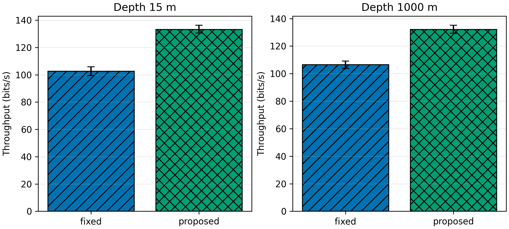
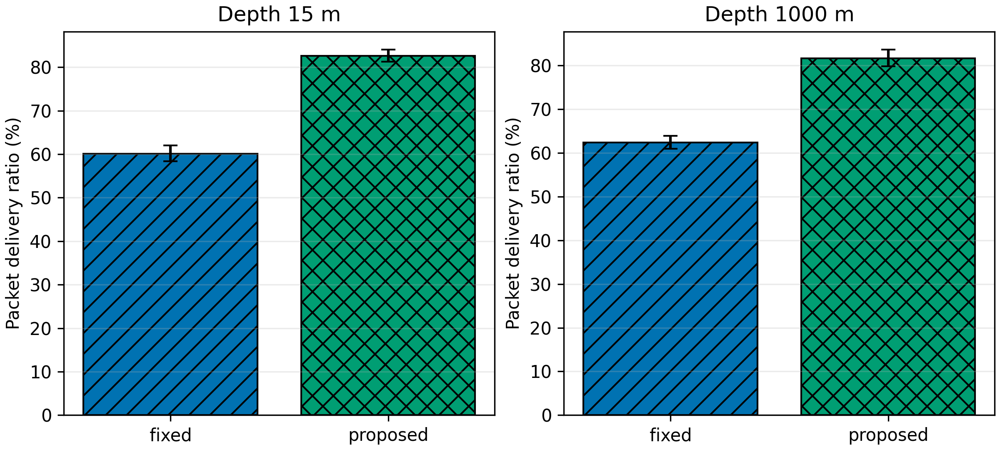

# Final Experimental Results — Protocol Version 3

## Evidence used

- UnetStack 7.0.0 with `ProtocolChannelModel`
- Moderate channel; untouched paired evaluation seeds 211–230 (`n = 20` per mode/depth)
- 60 s warm-up and 180 s measurement
- Receiver C at 15 m and 1000 m; horizontal position fixed at 2 km
- Baseline: fixed 3000 ms, ACK requested for every original, no application retry
- Frozen candidate `w2-e4-c3`, weights `0.15 RTT + 0.55 confirmed loss + 0.15 ACK failure + 0.15 timeout`
- Proposed recovery: two original ACK requests per ten-message window, one retry opportunity after four new originals, at most three retries per original window, and at most one retry per sequence ID

Useful metrics count unique application sequence IDs. Retries and duplicate deliveries cannot inflate throughput or PDR.

## Overall comparison

| Depth | Mode | Unique generated | Attempts | Retries | Unique delivered | PDR (%) | Throughput (bit/s) | Retry overhead (%) |
|---|---|---:|---:|---:|---:|---:|---:|---:|
| 15 m | Fixed | 60.00 | 60.00 | 0.00 | 36.05 | 60.08 | 102.54 | 0.00 |
| 15 m | Proposed | 56.75 | 60.00 | 3.25 | 46.85 | 82.57 | 133.26 | 5.42 |
| 1000 m | Fixed | 60.00 | 60.00 | 0.00 | 37.45 | 62.42 | 106.52 | 0.00 |
| 1000 m | Proposed | 56.90 | 60.00 | 3.10 | 46.45 | 81.68 | 132.12 | 5.17 |

Machine-readable source: [`overall_comparison.csv`](../results/v3/summary/overall_comparison.csv).

## Formal fixed-versus-proposed effects

| Depth | Throughput change | 95% bootstrap CI | PDR change | 95% bootstrap CI | Gate |
|---|---:|---:|---:|---:|---|
| 15 m | **+30.63%** | **+25.71% to +35.44%** | **+22.48 pp** | **+20.66 to +24.35 pp** | Pass |
| 1000 m | **+24.30%** | **+21.00% to +27.58%** | **+19.26 pp** | **+17.54 to +21.01 pp** | Pass |

The requested minimums were +5% useful throughput and +5 PDR percentage points at both depths. Every point estimate passes, and every paired interval excludes zero.

## Why the improvement occurs

The fixed baseline sends 60 originals and generates reverse-channel ACK traffic for all of them. Proposed mode uses the same paced opportunities for originals and retries, requests only two original ACKs per full window, and retries only IDs confirmed missing by an immutable receiver snapshot. It reduces avoidable reverse traffic and converts about 5.2–5.4% of DATA attempts into targeted recovery. The denominator remains the number of unique originals.

## Depth claim

Paired `1000 m − 15 m` useful-throughput effects were:

- Fixed: **+3.98 bit/s**, 95% CI **+0.57 to +7.82** — positive for this fixed-mode experiment.
- Proposed: **−1.14 bit/s**, 95% CI **−3.56 to +1.42** — inconclusive.

Therefore the evidence does **not** support the general statement that throughput increases as depth increases. Depth changes geometry, propagation time, and collision alignment; detection/decoding probabilities are not improved by depth.

## Evidence files

- [Paired effects](../results/v3/summary/paired_effects.csv)
- [Depth effects](../results/v3/summary/depth_effects.csv)
- [All 80 held-out runs](../results/v3/summary/run_summary.csv)
- [Frozen configuration](../results/v3/calibration/frozen-config.json)
- [Packet loss figure](../results/v3/figures/packet_loss.png)
- [RTT figure](../results/v3/figures/average_rtt.png)
- [Timeout figure](../results/v3/figures/timeout_ratio.png)

## Conclusion

Protocol version 3 meets the formal project target against fixed 3000 ms at both depths. The result uses 20 paired held-out seeds per depth, honest unique-message accounting, bounded retry overhead, exact manifest validation, and paired bootstrap intervals. Legacy mode is not the official baseline.
